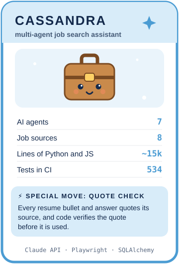
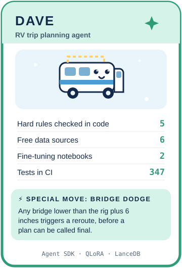
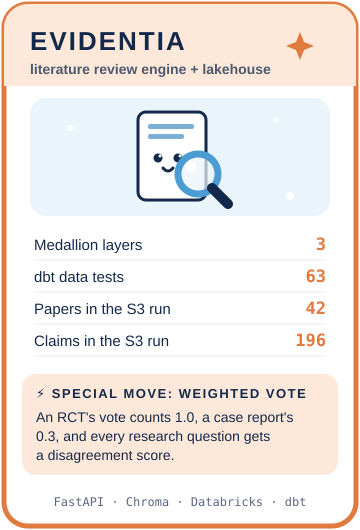

  

  
  
  
  

## 🃏 Meet the agents

  
  
  

### 💼 [Cassandra](https://github.com/armita-jamshidi/Apply_Auto): a multi-agent talent agent

Cassandra reads 8 job sources every morning, keeps only the roles that fit, scores each
one from 0 to 100, rewrites a one-page Word resume around the posting's exact keywords, and
drafts every application answer in the candidate's own voice. Then she stops, because the
candidate always clicks Submit.

- **A multi-agent system with an orchestrator in charge.** Given a goal ("5 strong kits"),
  the orchestrator calls tools (`find_new_jobs`, `score_jobs`, `read_application_form`,
  `build_kit`) to direct six specialist agents: a fit scorer, a careers agent with web
  search, a Playwright form agent, a library agent, and resume and answers sub-agents.
  Opus 5.5 takes the costly steps and Sonnet 5.5 the fast ones, and the run stops when the
  goal is met or a budget runs out.
- **Every agent checked in code.** Each answer and resume bullet must quote a real source
  and code verifies the quote, a job title counts only if it was seen on a page the agent
  opened, and no agent has a submit tool. 534 offline tests back this up in CI.

### 🚐 [Dave](https://github.com/armita-jamshidi/RV-trip-agent): an RV trip planner that measures first

Dave turns a plain-language request like "Denver to Moab, with museum stops" into daily
plans with campgrounds, stops, meals, fuel and a budget, then hands every booking to a
person to approve.

- **QLoRA fine-tuning of a small model to stand in for a big one.** A Colab notebook tunes
  Qwen2.5-3B-Instruct (4-bit NF4 base, LoRA rank 16 on all attention and MLP layers,
  completion-only loss) on 2,000 synthetic trip requests whose labels are correct by
  construction. Dave asks the tuned model first and falls back to Claude whenever its
  reply fails the schema.
- **Contrastive embedding fine-tuning.** bge-small is tuned with in-batch and hard
  negatives, scored by recall@5 and MRR on held-out campgrounds, and powers semantic
  campground search in LanceDB.

### 🔍 [Evidentia](https://github.com/armita-jamshidi/AI_powered_literature_review_engine): a RAG system and a lakehouse

Evidentia reads papers, extracts what each one claims, and scores how much the studies on
each question disagree, with stronger study designs getting a bigger vote.

- **A medallion lakehouse, bronze to gold.** Postgres exports to Parquet on AWS S3,
  PySpark cleans it into Delta Lake on Databricks with idempotent `MERGE` upserts and a
  quarantine table, and dbt builds a star schema with 63 data tests that feeds a Power BI
  dashboard.
- **A RAG pipeline over research papers.** PyMuPDF parsing, overlapping chunks, OpenAI
  embeddings in Chroma, and LLM structured extraction into typed claims, which are
  clustered by embedding similarity and served from an async FastAPI backend.

## 🛠️ Skills, with receipts

| Area | What I have built | Where to see it |
| --- | --- | --- |
| 🤖 **Multi-agent systems** | Orchestrator plus six agents with tool use loops, structured outputs, web search, refusal fallbacks and token tracking; an Agent SDK agent with in-process MCP tools | [Cassandra](https://github.com/armita-jamshidi/Apply_Auto), [Dave](https://github.com/armita-jamshidi/RV-trip-agent) |
| 🧪 **Fine-tuning and evaluation** | QLoRA on Qwen2.5-3B, contrastive embedding tuning, synthetic data labeled by construction, recall@5 and MRR, real-world eval harness | [Dave](https://github.com/armita-jamshidi/RV-trip-agent) |
| 📚 **RAG and grounded generation** | Chunking, embeddings, Chroma and LanceDB, agglomerative clustering of claims, quotes verified in code before a model's answer is used | [Evidentia](https://github.com/armita-jamshidi/AI_powered_literature_review_engine), [Cassandra](https://github.com/armita-jamshidi/Apply_Auto) |
| 🏞️ **Lakehouse data engineering** | S3 bronze, PySpark and Delta Lake silver, dbt gold, Unity Catalog, Power BI with DAX | [Evidentia](https://github.com/armita-jamshidi/AI_powered_literature_review_engine) |
| 🛡️ **Safe agent design** | No submit tool, approvals locked to a SHA-256 digest of the terms, validators that fail on unknown facts, a pre-commit hook that blocks personal data | [Cassandra](https://github.com/armita-jamshidi/Apply_Auto), [Dave](https://github.com/armita-jamshidi/RV-trip-agent) |
| ✅ **Testing without the network** | 913 offline pytest tests: fake LLM clients with scripted replies, recorded HTTP fixtures, headless Chromium against local forms, GitHub Actions CI | all three |

## 🧰 Tech stack

  
   
  
   
  

  
  
  
  
  
  
  
   
  
  
  
  
  
  
  
  

## 🐛 Bug hall of fame

<b>Six merged pull requests that never reached <code>main</code></b> (Dave)

 
Six reviewed PRs said "Merged" on GitHub, yet <code>main</code> had no campgrounds,
restaurants, budget or renderer. The PRs were stacked, and GitHub never retargeted them after
their base branches merged. One PR carried all six home, and decisions now live in one file
each so parallel branches can't collide. <a href="https://github.com/armita-jamshidi/RV-trip-agent/pull/36">PR #36</a>

<b>The careers agent made things up</b> (Cassandra)

 
It once reported a role from a search result it never opened, and once reported a list of
openings as the role. Code now accepts a job title only from a page the agent actually
opened, and follows a list to the role's own page.

<b>The blank browser window</b> (Cassandra)

 
<b>Fill with agent</b> opened Chrome on <code>about:blank</code>, and the console closed before
anyone could read the error. Four causes, fixed one at a time: make the error stay on screen,
detect Chrome's one-browser-per-profile lock, bring the window to the front on Windows, and
open Playwright with <code>no_viewport=True</code> so the form could scroll.

<b>Databricks wouldn't read my S3 bucket</b> (Evidentia)

 
A probe notebook showed the network could reach S3 but Spark was denied, because Databricks
Free Edition allows no external storage credentials. The export now lands the same Parquet
files in a Unity Catalog volume, and S3 stays the lake of record.

## 🗂️ Earlier projects

| Project | What it is | Built with |
| --- | --- | --- |
| [RML interpreter](https://github.com/armita-jamshidi/Limitless-Linear-Agebra-Calculator) | An interpreter for a small ML-style language with async promises: lexer, parser, type checker and evaluator | OCaml, Menhir, ocamllex, dune |
| [Sing Cornell](https://github.com/armita-jamshidi/Sing-Cornell) | Backend for an iOS app where Cornell students share their music, with song and cover-image endpoints | Flask, SQLAlchemy, boto3, Docker |
| [Peer-to-peer payments](https://github.com/armita-jamshidi/peer-to-peer-payment-app) | A Venmo-style backend for users paying each other, with 13 tests | Flask, SQLite |
| [Grading system backend](https://github.com/armita-jamshidi/Grading-System-Backend) | Users, courses and assignments linked through association tables | Flask, SQLAlchemy |
| [Ezragram](https://github.com/armita-jamshidi/webdev-101-dev-armita) | A small Instagram clone with Google sign-in, built for a web dev onboarding course | SvelteKit, PocketBase, Tailwind, Fly.io |

## 🐍 Contributions

  <picture>
    <source media="(prefers-color-scheme: dark)" srcset="https://raw.githubusercontent.com/armita-jamshidi/armita-jamshidi/output/github-snake-dark.svg">
    
  </picture>

